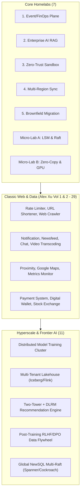
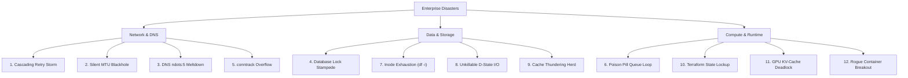

# The Master Homelab & Enterprise Systems Architecture Blueprint
### The Definitive 0.01% CCIE-Caliber Systems, Cloud, AI/MLOps, and SRE Execution Manual

---

## Table of Contents
1. [The 0.01% Master Framework: From Primitives to Principal Systems](#1-the-001-master-framework)
2. [The Periodic Table of System Design (16 Categories, 58 Primitives)](#2-the-periodic-table-of-system-design)
3. [The 47 Canonical System Architectures Catalog](#3-the-47-canonical-system-architectures-catalog)
4. [The 6-Lab Master Enterprise Architecture](#4-the-6-lab-master-enterprise-architecture)
   - [Lab 1: Sovereign Cloud, Multi-Tenancy & GitOps Foundation](#lab-1-sovereign-cloud-multi-tenancy--gitops-foundation)
   - [Lab 2: Autonomous Enterprise AI, vLLM & Agentic Evaluation Engine](#lab-2-autonomous-enterprise-ai-vllm--agentic-evaluation-engine)
   - [Lab 3: Real-Time Data Lakehouse, Streaming & FinOps Control Plane](#lab-3-real-time-data-lakehouse-streaming--finops-control-plane)
   - [Lab 4: Full-Stack App, Multi-Region Sync & Chaos SRE Cockpit](#lab-4-full-stack-app-multi-region-sync--chaos-sre-cockpit)
   - [Lab 5: Zero-Trust Security, Cryptographic Identity & Supply Chain Defense](#lab-5-zero-trust-security-cryptographic-identity--supply-chain-defense)
   - [Lab 6: Distributed Consensus, Durable Workflows & Brownfield Legacy Migration](#lab-6-distributed-consensus-durable-workflows--brownfield-legacy-migration)
5. [The 2 Weekend Micro-Labs: Deep Systems & Hardware Internals](#5-the-2-weekend-micro-labs)
   - [Micro-Lab A: LSM-Tree Storage Engine & 3-Node Raft Consensus from Scratch](#micro-lab-a-lsm-tree-storage-engine--3-node-raft-consensus-from-scratch)
   - [Micro-Lab B: Zero-Copy Kernel I/O & GPU Triton Roofline Profiling](#micro-lab-b-zero-copy-kernel-io--gpu-triton-roofline-profiling)
6. [The 12 Severe Enterprise Outages & Chaos War-Room Drills](#6-the-12-severe-enterprise-outages--chaos-war-room-drills)
7. [The Headless Multi-Cloud Emulator & Terminal Cockpit Toolkit](#7-the-headless-multi-cloud-emulator--terminal-cockpit-toolkit)
8. [The 60-Second Linux SRE Triage & Kernel Forensics Engine](#8-the-60-second-linux-sre-triage--kernel-forensics-engine)
9. [Docs-as-Code, Automated Discovery & Architecture Decision Records (ADRs)](#9-docs-as-code-automated-discovery--adrs)

---

## 1. The 0.01% Master Framework

> [!IMPORTANT]
> A top-0.01% Principal Systems Architect does not memorize marketing whitepapers or chase transient framework churn. They master the immutable physics of computing: Linux kernel syscalls, memory bus bandwidth, CPU cache-line alignment, TCP/IP network flows, and distributed consensus math.

```
+----------------------------------------------------------------------------------------------------+
|                                THE UNIFIED ARCHITECTURE STACK                                      |
+----------------------------------------------------------------------------------------------------+
|  LAYER 5: BUSINESS & GOVERNANCE    --> FinOps unit economics, SLOs/SLIs, Living ADRs, Compliance   |
|  LAYER 4: AI & DATA SYSTEMS        --> vLLM, Qdrant, Lakehouses (Iceberg), Streaming (Kafka), RAG  |
|  LAYER 3: DISTRIBUTED ORCHESTRATION --> Kubernetes, Raft, Temporal, Multi-Region Active-Active      |
|  LAYER 2: NETWORK & SERVICE MESH   --> mTLS, Envoy, eBPF (Cilium), Wire protocols, Anycast BGP     |
|  LAYER 1: LINUX OS & HARDWARE      --> Syscalls (epoll, io_uring), Memory (VRAM/RAM), Block I/O    |
+----------------------------------------------------------------------------------------------------+
```

### The 4-Tier Progression
1. **Tier 1: Primitives & Mechanics (90%):** Linux, Python, SQL, DSA, Docker, and core production patterns.
2. **Tier 2: Classic Distributed Systems (95%):** 29 classic architectural problem shapes (Alex Xu Vol 1 & 2), caching topologies, database sharding, and message queues.
3. **Tier 3: The 6 Full-Stack Enterprise Labs (98%):** Production-grade AI serving, zero-trust security, real-time lakehouses, and zero-downtime legacy migrations.
4. **Tier 4: Deep Systems & CCIE Forensics (0.01%):** Low-level LSM-tree/Raft implementation, zero-copy socket I/O, GPU Triton kernel profiling, and timed blind chaos troubleshooting.

---

## 2. The Periodic Table of System Design
### 16 Categories, 58 Building-Block Components

Every enterprise platform on Earth is constructed by wiring together a subset of these 58 components:

```
+--------------------+---------------------+---------------------+----------------------+
| 1. EDGE & TRAFFIC  | 2. COMPUTE RUNTIMES | 3. STORAGE & DBS    | 4. CACHING & POOLS   |
| 01. Anycast BGP    | 07. Stateless APIs  | 12. Relational OLTP | 19. Dist. RAM Cache  |
| 02. Geo-DNS        | 08. K8s Containers  | 13. Key-Value Store | 20. In-Process Cache |
| 03. Global CDN     | 09. Serverless FaaS | 14. Document / Wide | 21. DB Conn Poolers  |
| 04. WAF / DDoS     | 10. Async Workers   | 15. Columnar OLAP   | 22. Semantic Cache   |
| 05. L4/L7 Load Bal | 11. MicroVM Sandbox | 16. Time-Series DB  |                      |
| 06. API Gateway    |                     | 17. Graph Database  |                      |
|                    |                     | 18. Object/Blob S3  |                      |
+--------------------+---------------------+---------------------+----------------------+
| 5. MESSAGING/QUEUE | 6. SEARCH & GEO     | 7. REAL-TIME SYNC   | 8. CONSENSUS & LOCKS |
| 23. Message Queues | 27. Full-Text BM25  | 30. WebSockets/SSE  | 33. Raft/Paxos Store |
| 24. Commit Logs    | 28. Vector DB/HNSW  | 31. WebRTC Relays   | 34. Service Discovery|
| 25. Pub/Sub Fanout | 29. Geospatial H3/S2| 32. CRDTs / HLC     | 35. Dist. Lock/Lease |
| 26. Dead-Letter Q  |                     |                     | 36. Distributed UUID |
+--------------------+---------------------+---------------------+----------------------+
| 9. DATA PIPELINES  | 10. AI / ML INFRA   | 11. ZERO-TRUST SEC  | 12. OBSERVABILITY    |
| 37. DAG Schedulers | 40. Model Serving   | 43. OIDC / IdP      | 46. Metrics / Logs   |
| 38. Real-Time CDC  | 41. AI Gateways     | 44. RBAC / OPA IAM  | 47. Dist. Tracing    |
| 39. Stream Engines | 42. Eval Pipelines  | 45. Vault KMS/Envel | 48. FinOps Engines   |
+--------------------+---------------------+---------------------+----------------------+
| 13. EAST-WEST MESH | 14. MULTI-REGION    | 15. PROGRESSIVE ENG | 16. HARDWARE PHYSICS |
| 49. Service Mesh   | 52. Global ACID DB  | 55. Feature Flags   | 57. GPU Interconnect |
| 50. eBPF Datapath  | 53. WAN Sync / CRDT | 56. Chaos Engine    | 58. NVMe / IOPS Tier |
| 51. Egress Gateway | 54. Geo-Fencing Reg |                     |                      |
+--------------------+---------------------+---------------------+----------------------+
```

### Component Failure Modes & Capacity Heuristics

| ID | Component | Primary Failure Mode at 10M Users | Back-of-the-Envelope Capacity Rule |
| :--- | :--- | :--- | :--- |
| **05** | **L4/L7 Load Balancer** | Ephemeral port exhaustion; conntrack table saturation. | Max 65k concurrent TCP connections per outbound IP. |
| **12** | **Relational DB (OLTP)** | Connection pool starvation; lock contention on write spikes. | Sustained write cap: ~5,000-10,000 IOPS per single disk volume. |
| **15** | **Columnar OLAP (ClickHouse)** | Too many small parts (unbatched inserts triggering disk churn). | Min batch size: 10,000 rows or 1-second write buffers. |
| **19** | **Distributed Cache (Redis)** | Cache stampede (thundering herd) on hot key expiration. | Memory rule: Reserve 25% RAM overhead for BGSAVE fork. |
| **24** | **Commit Log (Kafka/Redpanda)** | Unbalanced partition keys causing consumer lag spikes. | Sizing: 1 partition $\approx$ 10 MB/sec write, 20 MB/sec read. |
| **28** | **Vector DB (Qdrant)** | RAM exhaustion (HNSW index memory explosion). | HNSW RAM = $\text{Vectors} \times (\text{Dims} \times 4 + M \times 8 \text{ bytes})$. |
| **33** | **Consensus Store (etcd)** | Fsync disk latency jitter causing leader election flip-flops. | Must have $<10\text{ms}$ sustained p99 disk fsync latency. |
| **40** | **Model Serving (vLLM)** | KV-cache memory saturation stalling concurrent requests. | VRAM = Model Weights + $(\text{Context Length} \times \text{Layers} \times \text{Concurrency})$. |
| **50** | **eBPF Datapath (Cilium)** | Node map exhaustion (`bpf_map__create` limit hit). | Monitor eBPF tail calls and map memory allocations. |

---

## 3. The 47 Canonical System Architectures Catalog

To achieve universal 100% architectural coverage, master these 47 distinct canonical blueprints:



### Complete Numerical Directory (1–47)
- **Homelab Flagships & Micro-Labs (1–7):**
  1. *Real-Time Telemetry & FinOps Metering Plane* (Kafka + ClickHouse + Redis sliding window).
  2. *Autonomous Enterprise AI & Agentic RAG Platform* (vLLM + Qdrant + Arize Phoenix).
  3. *Zero-Trust Distributed Workflow & Code Sandbox* (Temporal + Linux namespaces + Vault).
  4. *Multi-Region Globally Replicated Collaborative Sync* (CRDTs + WebSocket backplanes).
  5. *Zero-Downtime Legacy Monolith-to-Distributed Migration* (Debezium CDC + Strangler Fig).
  6. *Pure-Code LSM-Tree Storage Engine & 3-Node Raft Consensus* (Micro-Lab A).
  7. *Zero-Copy Network Server & GPU Triton Kernel Profiler* (Micro-Lab B).
- **Classic Distributed Case Studies (8–36 - Alex Xu Vol 1 & 2):**
  8. *Rate Limiter* (Token bucket, Leaky bucket, Sliding window logs).
  9. *Consistent Hashing Ring* (Virtual nodes, minimal key relocation).
  10. *Unique ID Generator* (Twitter Snowflake, 64-bit time-ordered).
  11. *URL Shortener* (Base62 encoding, bloom filters for collisions).
  12. *Distributed Web Crawler* (Politeness delay, URL frontier, robots.txt parsing).
  13. *Notification System* (Multi-channel push/SMS/email, deduplication).
  14. *News Feed System* (Fan-out on write vs. fan-out on read).
  15. *Real-Time Chat Application* (WebSocket connection management, presence servers).
  16. *Video Transcoding & Streaming* (HLS/DASH chunking, DAG task scheduler).
  17. *Cloud Object Storage* (Data placement, erasure coding, metadata partitioning).
  18. *Search Autocomplete* (Trie data structure, frequency caching).
  19. *Proximity Service* (Geohash, Quadtree, dynamic radius querying).
  20. *Nearby Friends* (Redis Pub/Sub, live location TTL beacons).
  21. *Google Maps & Routing* (Graph contraction hierarchies, ETA estimation).
  22. *Distributed Message Queue* (Segmented commit log, zero-copy socket transfers).
  23. *Metrics Monitoring & Alerting* (Time-series compaction, downsampling).
  24. *Ad Click Event Aggregation* (Streaming tumbling windows, watermarking).
  25. *Hotel Reservation & Booking* (Pessimistic vs. optimistic locking, double-booking prevention).
  26. *Distributed Payment Gateway* (Idempotent charges, reconciliation engines).
  27. *Digital Wallet* (Double-entry accounting ledger, balance validation).
  28. *Stock Exchange Matching Engine* (LMAX Disruptor ring-buffer, price-time priority).
  29. *Distributed Key-Value Store* (Dynamo-style vector clocks, gossip protocol).
  30. *Web Collaboration Suite* (Operational Transformation vs. CRDTs).
  31. *Email Delivery & Spam Engine* (Reputation tracking, queue prioritization).
  32. *Social Network Graph* (Bidirectional BFS, relationship edge caching).
  33. *Multi-Tier CDN* (Consistent caching, cache stampede collapse).
  34. *Distributed Cloud Task Scheduler* (Delayed task execution, wheel timers).
  35. *Gaming Leaderboard* (Redis Sorted Sets, skip-list rank queries).
  36. *Flash Sale / Virtual Queue* (Token-bucket gating, Redis Lua scripts).
- **Hyperscale Frontier & AI Infrastructure (37–47):**
  37. *Multi-Node Distributed Model Training Farm* (3D Parallelism: Data, Tensor, Pipeline).
  38. *Multi-Tenant Lakehouse & Streaming Feature Store* (Apache Iceberg + Flink + MinIO).
  39. *Zero-Trust Enterprise Service Mesh* (SPIFFE/SPIRE workload attestation, Envoy xDS).
  40. *Global NewSQL Database* (Spanner-style Multi-Raft + Hybrid Logical Clocks).
  41. *High-Throughput Observability Pipeline (10M Spans/sec)* (OpenTelemetry + ClickHouse).
  42. *Distributed MicroVM Build Farm* (Firecracker container virtualization).
  43. *Autonomous Multi-Agent Orchestrator* (Deterministic replay, tool guardrails).
  44. *Hyperscale Recommendation Funnel* (Two-Tower ANN Candidate Generation + DLRM Ranking).
  45. *Post-Training RLHF/DPO Data Flywheel* (Synthetic generation, deduplication, LoRA/FSDP).
  46. *Global Edge Isolate Runtime* (V8 isolates, BGP Anycast, zero cold-starts).
  47. *Cell-Based Multi-Region Disaster Recovery* (Autonomous cell routing, blast-radius bounds).

---

## 4. The 6-Lab Master Enterprise Architecture

```
+----------------------------------------------------------------------------------------------------+
|                               THE UNIFIED 6-LAB PLATFORM BLUEPRINT                                 |
+----------------------------------------------------------------------------------------------------+
|                                                                                                    |
|  [LAB 1: Sovereign Cloud & GitOps Engine]                                                          |
|    LocalStack / Floci + Kind Multi-Node K8s + Cilium eBPF + ArgoCD GitOps + OpenTofu               |
|                                 |                                                                  |
|  [LAB 5: Zero-Trust Security]   v                                  [LAB 6: Consensus & Migration]  |
|  Vault / OpenBao + Keycloak OIDC + SPIRE mTLS + Tetragon eBPF      Patroni HA Postgres + Temporal  |
|                                 |                                  Debezium CDC + Envoy Proxies    |
|                                 +------------------+---------------+                               |
|                                                    |                                               |
|                    +-------------------------------+-------------------------------+               |
|                    |                                                               |               |
|                    v                                                               v               |
|  [LAB 3: Data Lakehouse & FinOps]                                [LAB 2: Enterprise AI Engine]     |
|  Redpanda / Kafka Streaming                                      vLLM Inference (Quantized)        |
|  ClickHouse Columnar OLAP                                        Qdrant Hybrid Vector / BM25       |
|  MinIO (S3) Iceberg Tables + DuckDB                              LiteLLM AI Gateway + Cache        |
|  Prefect / Dagster Orchestrator                                  Arize Phoenix Eval CI/CD          |
|                    |                                                               |               |
|                    +-------------------------------+-------------------------------+               |
|                                                    |                                               |
|                                                    v                                               |
|                                  [LAB 4: Full-Stack App & SRE Cockpit]                             |
|                                  FastAPI + Next.js UI + Redis Cluster                              |
|                                  OpenTelemetry + Prometheus + Grafana                              |
|                                  Chaos Mesh Automated Failure Injection                            |
+----------------------------------------------------------------------------------------------------+
```

### Lab 1: Sovereign Cloud, Multi-Tenancy & GitOps Foundation
* **Target Roles:** Cloud Architect, Platform Engineer, DevOps Engineer.
* **Core Stack:** OpenTofu, LocalStack / Floci, Kind (3-node K8s), ArgoCD, Cilium eBPF.
* **The Engineering Objective:** Build a 100% declarative cloud ecosystem locally with zero long-lived credentials, zero manual kubectl interventions, and multi-tenant isolation.
* **Architecture & Topology:**
  - `kind-cluster`: 1 control-plane node, 2 worker nodes. Default CNI disabled.
  - `Cilium`: Installed as CNI with eBPF kube-proxy replacement, host routing, and Hubble observability.
  - `LocalStack`: Emulates AWS S3, IAM, SQS, DynamoDB on `:4566`.
  - `ArgoCD`: Deployed in `argocd` namespace, continuously reconciling Git repository manifests.
* **The Killer Test:** Execute `tofu destroy && tofu apply` followed by `kind delete cluster && ./bootstrap.sh`. The entire cluster, networks, storage, and services must self-heal to 100% functional state within 7 minutes without human touch.

### Lab 2: Autonomous Enterprise AI, vLLM & Agentic Evaluation Engine
* **Target Roles:** AI Systems Engineer, MLOps Architect, Frontier RAG Developer.
* **Core Stack:** vLLM, Ollama, Qdrant, LiteLLM, Redis Stack, Arize Phoenix, Promptfoo.
* **The Engineering Objective:** Build a sub-2.5-second, multi-tenant RAG and agentic execution engine that eliminates hallucinations and cuts GPU token spend by 65%.
* **Architecture & Topology:**
  - `Ingestion Pipeline`: Unstructured documents parsed, chunked, and embedded into Qdrant with dense vectors + sparse BM25 indices.
  - `Inference Layer`: vLLM running AWQ/FP8 quantized open-weights models with PagedAttention and continuous batching.
  - `Semantic Cache`: Redis vector cache intercepting repetitive prompts (cosine similarity $>0.92$) to return cached outputs in $<15\text{ms}$.
  - `Eval Gate`: Phoenix/Promptfoo pipeline running in CI/CD against 100 golden QA pairs. Blocks merges if faithfulness drops below 0.95 or latency exceeds 2.5s.
* **Chaos Drill:** Saturate vLLM with 200 concurrent requests, fill KV cache memory to 100%, and watch PagedAttention prevent OOM while LiteLLM sheds non-critical load.

### Lab 3: Real-Time Data Lakehouse, Streaming & FinOps Control Plane
* **Target Roles:** Data Architect, Streaming Engineer, FinOps Specialist.
* **Core Stack:** Redpanda, MinIO (S3), Apache Iceberg, ClickHouse, DuckDB, Dagster, PostgreSQL.
* **The Engineering Objective:** Ingest 15,000 events/second, track exact compute/storage unit cost per tenant in real time, and enforce budget circuit breakers with zero data loss.
* **Architecture & Topology:**
  - `Redpanda`: Partitioned event stream capturing telemetry and payment events.
  - `ClickHouse`: Real-time OLAP ingesting directly from Redpanda via Kafka Engine tables.
  - `MinIO + Iceberg`: Cold data tiered from ClickHouse to parquet files on S3 via Dagster compaction jobs.
  - `FinOps Metering`: Stream processor computing running dollar burn per tenant. Enforces HTTP 429 throttling via Redis sliding-window counters when budget hits 100%.
* **Chaos Drill:** Inject 5,000 duplicate events per second during a simulated 3-minute ClickHouse outage. Verify that Redpanda buffers the stream, and upon ClickHouse recovery, idempotent deduplication yields exact penny-level billing balances.

### Lab 4: Full-Stack App, Multi-Region Sync & Chaos SRE Cockpit
* **Target Roles:** Staff SRE, Full-Stack Distributed Systems Engineer.
* **Core Stack:** Next.js, FastAPI, PostgreSQL (HA), Redis Cluster, OpenTelemetry, Chaos Mesh, k6.
* **The Engineering Objective:** Operate a multi-tenant, real-time streaming application under continuous automated chaos and prove sub-300ms p99 latency.
* **Architecture & Topology:**
  - `Frontend`: Next.js 14 App Router rendering real-time dashboards via WebSockets.
  - `Backend`: FastAPI asynchronous API cluster instrumented with OpenTelemetry SDK.
  - `Database`: PostgreSQL configured with read-replicas, PgBouncer transaction pooling, and `SELECT FOR UPDATE` locking.
  - `Chaos Engine`: Chaos Mesh scheduled to inject 20% packet drops, pod crashes, and DNS failures every 30 minutes while k6 runs a sustained 1,000 RPS workload.
* **Chaos Drill:** Trigger an active database node kill during a financial checkout surge. Verify PgBouncer fails over to the standby replica, the Transactional Outbox pattern prevents double-charging, and OpenTelemetry traces reveal the exact failover latency spike.

### Lab 5: Zero-Trust Security, Cryptographic Identity & Supply Chain Defense
* **Target Roles:** Principal Security Architect, DevSecOps Engineer.
* **Core Stack:** OpenBao / Vault, Keycloak (OIDC), SPIFFE/SPIRE, Cosign, Trivy, Cilium Tetragon.
* **The Engineering Objective:** Build an impenetrable enterprise envelope: zero hardcoded secrets, zero lateral container movement, and automated kernel-level execution kill-switches.
* **Architecture & Topology:**
  - `Identity Plane`: Keycloak issuing short-lived OIDC JWTs. SPIRE server attesting pods and issuing X.509 SVID mTLS certs rotated every 30 minutes.
  - `Secrets Engine`: Vault dynamic secrets generating single-use, 15-minute PostgreSQL credentials for backend pods.
  - `Supply Chain Gate`: Kubernetes admission controller verifying Cosign cryptographic image signatures. Unsigned images blocked automatically.
  - `Runtime Defense`: Cilium Tetragon monitoring kernel syscalls. Instantly issues `SIGKILL` if any pod attempts to spawn an interactive shell or read `/etc/shadow`.
* **Chaos Drill:** Exec into a running production pod and attempt to run `curl http://169.254.169.254` (cloud metadata exfiltration) or `nmap` internal subnets. Watch Tetragon terminate the process in 2 microseconds and log the security audit event.

### Lab 6: Distributed Consensus, Durable Workflows & Brownfield Legacy Migration
* **Target Roles:** Principal Distributed Systems Architect, Enterprise Migration Lead.
* **Core Stack:** Temporal, Debezium CDC, Kafka/Redpanda, Patroni HA Postgres, Envoy Proxy, Infracost.
* **The Engineering Objective:** Migrate a bleeding, 10-million-row legacy monolith to a distributed event-driven architecture under live traffic with zero downtime and zero data divergence.
* **Architecture & Topology:**
  - `Legacy Core`: Monolithic PostgreSQL database bombarded with 3,000 RPS via k6.
  - `CDC Synchronization`: Debezium capturing PostgreSQL Write-Ahead Logs (WAL) and streaming changes into Redpanda in real time.
  - `Strangler Fig & Traffic Mirroring`: Envoy proxy splitting incoming production requests: 100% routed to legacy, 100% mirrored (shadowed) asynchronously to the new microservice for response diffing.
  - `Durable Orchestration`: Temporal managing multi-step saga workflows (Payment $\to$ Inventory $\to$ Notification) with automatic compensating transactions on failure.
* **Chaos Drill:** Kill the new microservice during a 50% canary traffic cutover. Verify Envoy's automated outlier detection falls back 100% of traffic to the legacy monolith in $<2$ seconds with zero 5xx errors returned to clients.

---

## 5. The 2 Weekend Micro-Labs
### Deep Systems & Hardware Internals (The Final 2%)

### Micro-Lab A: LSM-Tree Storage Engine & 3-Node Raft Consensus from Scratch
* **Time Commitment:** 1 Weekend (12–16 Hours).
* **The Goal:** Demystify how Kafka, Cassandra, ClickHouse, and etcd work internally by writing the core data structures from scratch in Python or Go.

#### Part 1: The 300-Line LSM-Tree Storage Engine
Build a fully working key-value store with:
1. **Append-Only WAL:** Every `put(key, val)` appends to an on-disk binary log for crash durability.
2. **MemTable:** In-memory sorted structure (Skip List or Red-Black Tree).
3. **Flushing & SSTables:** When MemTable reaches 4MB, freeze and flush to disk as an immutable Sorted String Table (SSTable) with a sparse index and Bloom Filter.
4. **Compaction:** Background thread running Two-Way Merge Sort across old SSTables to delete tombstoned records and eliminate duplicate keys.

```
[Write Request] ---> [Append-Only WAL (Disk)]
                 ---> [In-Memory MemTable (RAM)]
                             |
                   (When MemTable > 4MB)
                             v
                     [Flush to SSTable]
              +-------------------------------+
              | Data:   [k1:v1, k4:v4, k7:v7] |
              | Filter: [Bloom Filter (Bits)] |
              | Index:  [k1 -> 0, k7 -> 2048] |
              +-------------------------------+
```

#### Part 2: The 3-Node Raft Consensus Cluster
Build a minimal Raft engine communicating over raw TCP sockets:
1. **Leader Election:** Heartbeats (`Ping`), randomized election timers (150ms–300ms), `RequestVote` RPCs, and Term counters.
2. **Log Replication:** `AppendEntries` RPC requiring acknowledgment from a majority quorum ($\lfloor N/2 \rfloor + 1 = 2$ nodes) before committing state.
3. **Split-Brain Drill:** Sever network connectivity to the Leader node. Watch the remaining 2 nodes elect a new Leader, write entries, reconnect the old Leader, and watch the old Leader step down and reconcile its uncommitted log.

---

### Micro-Lab B: Zero-Copy Kernel I/O & GPU Triton Roofline Profiling
* **Time Commitment:** 1 Weekend (10–14 Hours).
* **The Goal:** Master OS-level zero-copy socket physics and GPU memory bandwidth profiling.

#### Part 1: Zero-Copy Linux Sockets (`sendfile` vs. Naive Buffers)
1. Write a naive HTTP file server that reads 1GB files into user-space RAM via `f.read(4096)` and writes them to a socket via `sock.send()`.
2. Measure with `perf stat -e context-switches,cpu-migrations,page-faults` and `strace -c`.
3. Rewrite the server using `os.sendfile(out_fd, in_fd, offset, count)` or Linux `splice`.
4. Observe: Context switches drop by 90%, CPU utilization falls from 65% to $<2\%$, and user-space memory allocations drop to zero as data transfers directly from OS Page Cache to the NIC DMA buffer.

#### Part 2: GPU Roofline Math & OpenAI Triton Kernel Profiling
1. **The Math (Roofline Model):**
   $$\text{Attainable Performance (TFLOPs)} = \min(\text{Peak Compute FLOPs}, \text{Memory Bandwidth (GB/s)} \times \text{Operational Intensity})$$
2. Profile a standard PyTorch matrix multiplication or Softmax using `torch.profiler` or NVIDIA Nsight Systems (`nsys`).
3. Write a custom fused Softmax kernel in OpenAI Triton. Compare kernel launch overhead, SRAM vs. HBM memory access patterns, and prove why kernel fusion accelerates LLM inference by eliminating round-trips to GPU global memory.

---

## 6. The 12 Severe Enterprise Outages & Chaos War-Room Drills

These 12 scenarios account for over 90% of all catastrophic outages at enterprise scale. Master their symptoms, kernel footprints, and architectural mitigations:



### Detailed Outage Diagnostic Matrix

| # | Outage Scenario | Root Cause & Failure Mechanism | Triage & Forensic Commands | Permanent Production Fix |
| :--- | :--- | :--- | :--- | :--- |
| **01** | **Cascading Retry Storm** | Downstream latency causes un-jittered clients to retry simultaneously, multiplying load 20x. | `ss -s`, `tcpdump -nn -c 100`, Grafana request rate derivative. | Exponential backoff with Full Jitter; token-bucket load shedding at gateway. |
| **02** | **Silent MTU Blackhole** | Small packets (ping/health) pass; packets $>1400$ bytes drop silently due to overlay encapsulation. | `ping -M do -s 1472 <IP>`, `tcpdump -v 'ip[6:2] & 0x3fff != 0'`. | Path MTU Discovery (PMTUD) or clamp TCP MSS via iptables (`TCPMSS --clamp-mss-to-pmtu`). |
| **03** | **DNS ndots:5 Meltdown** | Kubernetes default `ndots:5` triggers 5 search-path DNS queries per external request. | `tcpdump -nn -i any udp port 53`, `hubble observe --protocol dns`. | Set `ndots:2` in pod `dnsConfig`; deploy NodeLocal DNSCache daemonset. |
| **04** | **Database Lock Stampede** | Unindexed `ALTER TABLE` or unindexed foreign key lock blocks concurrent write threads. | `SELECT pid, query, age(clock_timestamp(), query_start), state FROM pg_stat_activity WHERE wait_event_type = 'Lock';` | Set `lock_timeout = '2s'`; execute migrations via Expand-and-Contract. |
| **05** | **conntrack Table Overflow** | Surge of short-lived connections fills Linux kernel netfilter table; new SYNs dropped. | `dmesg \| grep nf_conntrack`, `cat /proc/sys/net/netfilter/nf_conntrack_count`. | Increase `nf_conntrack_max`; enable TCP KeepAlive; reuse persistent HTTP connection pools. |
| **06** | **Poison Pill Queue Loop** | Corrupt message crashes consumer pod; K8s restarts it; pod re-reads corrupt message indefinitely. | `kubectl get pods -w` (CrashLoopBackOff); check consumer group lag in Redpanda. | Implement Dead-Letter Queue (DLQ) with max retry counter (3 strikes $\to$ quarantine). |
| **07** | **Inode Exhaustion** | Millions of 1KB temporary files consume 100% of filesystem inodes while disk space is 50% free. | `df -i` (shows 100% IFree exhausted), `find / -xdev -printf '%h\n' \| sort \| uniq -c \| sort -k 1 -nr \| head -n 10`. | Automated cron cleanup of tmpfs/session directories; consolidate files into Tar/S3. |
| **08** | **Unkillable D-State I/O Freeze** | Process hangs in uninterruptible disk I/O; `kill -9` fails; load average explodes. | `ps aux \| awk '$8 ~ /D/'`, `cat /proc/<PID>/stack`. | Fix underlying NFS/storage network path; configure hardware I/O watchdog timers. |
| **09** | **Cache Thundering Herd** | High-traffic key expires in Redis; 20,000 requests hit PostgreSQL at the same millisecond. | `pg_top`, `redis-cli --latency`, CPU spike on primary DB. | Mutex locking on cache miss (SingleFlight pattern); probabilistic early expiration (XFetch). |
| **10** | **Terraform State Lock Drift** | CI job aborts mid-apply leaving cloud state locked and half-configured. | `tofu force-unlock <LOCK_ID>`, `tofu plan -detailed-exitcode`. | S3 backend with DynamoDB locking; break state into small, decoupled modular stacks. |
| **11** | **GPU KV-Cache Deadlock** | Concurrent long-context prompts saturate vLLM GPU memory; scheduling queues stall. | `nvidia-smi dmon`, `vllm:num_requests_waiting` metric. | Enable chunked prefill; enforce max context limits; scale out worker nodes with HPA. |
| **12** | **Rogue Container Breakout** | Compromised supply-chain package attempts to read host `/etc/shadow` or scan network. | `kubectl gadget trace exec`, Tetragon alert log. | Deploy read-only root filesystems, drop `ALL` Linux capabilities, enforce AppArmor/Tetragon. |

---

## 7. The Headless Multi-Cloud Emulator & Terminal Cockpit Toolkit

### Master Installation Script (`install-ops.sh`)
Execute this script to configure all terminal dashboards, emulators, and profiling utilities:

```bash
#!/usr/bin/env bash
set -euo pipefail

echo "=== [1/5] Installing Core CLI Power Tools ==="
brew install tmux zellij jq fzf graphviz htop curlie

echo "=== [2/5] Installing Live Terminal Dashboards (TUIs) ==="
brew install k9s lazydocker inframap
brew install --cask clawscli/tap/claws
brew install huseyinbabal/tap/taws
brew install keidarcy/tap/e1s
brew install huseyinbabal/tap/tgcp

echo "=== [3/5] Installing Cloud SQL & IaC Visualizers ==="
brew install turbot/tap/steampipe
steampipe plugin install aws gcp azure kubernetes github
brew install turbot/tap/powerpipe
brew install d2

echo "=== [4/5] Pulling Core Cloud & AI Emulator Docker Images ==="
docker pull public.ecr.aws/aws-emulator/aws-emulator:latest
docker pull floci/floci:latest
docker pull mcr.microsoft.com/azure-storage/azurite:latest
docker pull gcr.io/google.com/cloudsdktool/google-cloud-cli:emulators
docker pull qdrant/qdrant:latest
docker pull localstack/localstack:latest

echo "=== [5/5] Installing Python Systems Engineering Tools ==="
pip install --upgrade diagrams cartography Infracost promptfoo

echo ">>> All systems operational. Launch cockpit with: make ops"
```

### Master Project Makefile
Drop this `Makefile` into the root of your monorepo:

```makefile
.PHONY: ops k8s docker cloud-up cloud-down query map-png map-rover test-chaos

# Launch unified 3-pane SRE cockpit
ops:
	tmux new-session -d -s cockpit 'claws --read-only' \; \
	split-window -h 'k9s' \; \
	split-window -v 'steampipe query' \; \
	select-pane -t 0 \; \
	attach-session -t cockpit

# Live Terminal Dashboards
k8s:
	k9s

docker:
	lazydocker

# Multi-Cloud Emulator Controls
cloud-up:
	docker compose -f deployments/docker-compose.multicloud.yml up -d

cloud-down:
	docker compose -f deployments/docker-compose.multicloud.yml down

# Run SQL Queries Across Infrastructure
query:
	steampipe query

# Generate Architecture Diagram as Code
map-png:
	python3 scripts/generate_architecture.py
	@echo "Saved to docs/architecture.png"

# Launch Interactive Terraform Dependency Map
map-rover:
	docker run --rm -it -p 9000:9000 -v $$(pwd):/src im2nguyen/rover

# Run Automated SRE Chaos Drill
test-chaos:
	bash scripts/inject_chaos_roulette.sh
```

### Multi-Cloud Master Emulator Compose (`docker-compose.multicloud.yml`)
```yaml
version: '3.8'

services:
  # 1. AWS Official Emulator (:4566)
  aws-emulator:
    image: public.ecr.aws/aws-emulator/aws-emulator:latest
    container_name: aws-emulator
    ports:
      - "4566:4566"
    environment:
      - AWS_DEFAULT_REGION=us-east-1

  # 2. Azure Storage Emulator - Azurite (:10000-10002)
  azure-azurite:
    image: mcr.microsoft.com/azure-storage/azurite:latest
    container_name: azure-azurite
    ports:
      - "10000:10000"
      - "10001:10001"
      - "10002:10002"
    volumes:
      - azurite_data:/data

  # 3. GCP Pub/Sub Emulator (:8085)
  gcp-pubsub:
    image: gcr.io/google.com/cloudsdktool/google-cloud-cli:emulators
    container_name: gcp-pubsub
    command: gcloud beta emulators pubsub start --host-port=0.0.0.0:8085
    ports:
      - "8085:8085"

  # 4. Multi-Tenant Central OIDC Identity Provider (:8080)
  keycloak:
    image: quay.io/keycloak/keycloak:latest
    container_name: keycloak-idp
    command: start-dev
    ports:
      - "8080:8080"
    environment:
      - KEYCLOAK_ADMIN=admin
      - KEYCLOAK_ADMIN_PASSWORD=adminpassword

volumes:
  azurite_data:
```

---

## 8. The 60-Second Linux SRE Triage & Kernel Forensics Engine

When an alarm triggers on a misbehaving server or Kubernetes node, execute these 10 commands in order. Complete the pass in under 60 seconds:

```
+----------------------------------------------------------------------------------------------------+
|                                THE 60-SECOND LINUX TRIAGE LOOP                                     |
+----------------------------------------------------------------------------------------------------+
|  1. uptime               --> Load average vs CPU core count (Is load spiking or dying?)            |
|  2. dmesg -T | tail -25  --> Check kernel log (Did OOM-killer kill a process? Disk I/O errors?)    |
|  3. vmstat 1 5           --> Run queue ('r' > cores = CPU starve; 'wa' > 0 = Disk I/O wait)       |
|  4. mpstat -P ALL 1 3    --> Check CPU imbalance (Is one single core pinned at 100% by interrupts?) |
|  5. pidstat 1 3          --> Which exact process PID is hogging CPU cycles or disk throughput?     |
|  6. iostat -xz 1 3       --> Check disk saturation (%util > 90%? await latency > 20ms?)            |
|  7. free -m              --> Available RAM vs page cache (Are we dipping into swap space?)         |
|  8. sar -n DEV 1 3       --> Network interface throughput (Are we saturating NIC bandwidth?)       |
|  9. ss -s                --> Socket overview (Thousands of sockets trapped in TIME_WAIT / CLOSE_WAIT?)|
| 10. top / htop           --> Final holistic check of thread states and memory allocation.          |
+----------------------------------------------------------------------------------------------------+
```

### The Brendan Gregg USE Method Protocol
For every critical resource, evaluate:
1. **Utilization:** The percentage of time the resource was busy (e.g., `iostat %util`, `mpstat %usr`).
2. **Saturation:** The degree to which work is queued waiting for the resource (e.g., `vmstat r` run queue, TCP listen backlog).
3. **Errors:** Explicit failure counters (e.g., `netstat -s` retransmits, disk controller read errors in `dmesg`).

### Deep Kernel Weapons
- **Syscall Snooping:**
  ```bash
  # Watch all file opens across the entire OS live
  sudo bpftrace -e 'tracepoint:syscalls:sys_enter_openat { printf("%s %s\n", comm, str(args->filename)); }'
  ```
- **Live TCP Drop Tracing:**
  ```bash
  # See which kernel function dropped a network packet
  sudo bpftrace -e 'kprobe:kfree_skb { printf("Dropped skb by: %s\n", ksym(reg("ip"))); }'
  ```
- **Application Stalling Inspection:**
  ```bash
  # Attach strace with microsecond timestamps to a hung process
  sudo strace -T -tt -p <PID> -f -e trace=network,file,desc
  ```

---

## 9. Docs-as-Code, Automated Discovery & ADRs

### Automated Diagrams-as-Code Generator (`scripts/generate_architecture.py`)
Run `python3 scripts/generate_architecture.py` to compile your architecture into a verified PNG diagram committed directly to Git:

```python
from diagrams import Diagram, Cluster, Edge
from diagrams.aws.compute import EKS
from diagrams.aws.storage import S3
from diagrams.onprem.queue import Kafka
from diagrams.onprem.database import PostgreSQL
from diagrams.onprem.inmemory import Redis
from diagrams.onprem.analytics import Clickhouse
from diagrams.onprem.mlops import Mlflow

with Diagram("Master_Enterprise_Systems_Platform", show=False, direction="LR", filename="docs/architecture"):
    with Cluster("Edge Ingress & Identity"):
        k8s = EKS("Cilium eBPF K8s Cluster")

    with Cluster("Real-Time Event & Data Lakehouse"):
        stream = Kafka("Redpanda Event Log")
        olap = Clickhouse("ClickHouse OLAP")
        lake = S3("MinIO Iceberg Storage")
        stream >> Edge(label="Batched Ingest") >> olap
        olap >> Edge(label="Cold Tiering") >> lake

    with Cluster("Transactional Core & AI Serving"):
        db = PostgreSQL("Patroni HA Postgres")
        cache = Redis("Redis Cluster / Semantic Cache")
        vllm = Mlflow("vLLM Model Serving")
        k8s >> db
        k8s >> cache
        k8s >> vllm

    k8s >> stream
```

### Architecture Decision Record (ADR) Standard
Maintain all major technical choices as version-controlled Markdown files in `docs/adr/NNN-title.md`:

```markdown
# ADR-0004: Selection of ClickHouse over Elasticsearch for FinOps Telemetry

## Status
Accepted (2026-11-22)

## Context
Our telemetry ingestion pipeline processes 15,000 events/sec ($~1.3\text{B}$ events/day). 
We require real-time SQL aggregation across tenant dollar spend with sub-second dashboard latencies. 
Elasticsearch cluster costs scale linearly with index size; JSON storage overhead and JVM garbage collection 
spikes create memory pressure at high ingestion rates.

## Decision
We select ClickHouse as the primary columnar storage engine for analytical metrics and FinOps telemetry, 
interfaced via Redpanda stream connectors.

## Consequences & Trade-Offs
- Positive: Columnar compression achieves 8:1 disk savings compared to raw JSON.
- Positive: Vectorized query execution allows multi-million row scans in $<100\text{ms}$.
- Negative: ClickHouse requires batched inserts ($>10,000$ rows) to prevent part-merge thrashing.
- Mitigation: All writes buffer through Redpanda and Kafka Engine tables before persistent commitment.
```

---

## 10. Execution Roadmap & Mastery Checklist

To systematically master this entire curriculum without feeling overwhelmed, execute via this structured sequence:

```
+----------------------------------------------------------------------------------------------------+
|                               THE 12-WEEK SYSTEMATIC MASTERY ROADMAP                               |
+----------------------------------------------------------------------------------------------------+
|  WEEKS 01-02: Lab 1 (Cloud, Kubernetes, Cilium eBPF, ArgoCD) + Micro-Lab A (LSM & Raft)            |
|  WEEKS 03-04: Lab 3 (Redpanda, ClickHouse, MinIO Iceberg Lakehouse, FinOps Metering)              |
|  WEEKS 05-06: Lab 2 (vLLM, Qdrant Hybrid RAG, Semantic Cache, Phoenix Evals) + Micro-Lab B        |
|  WEEKS 07-08: Lab 5 (Vault Dynamic Secrets, Keycloak OIDC, SPIRE mTLS, Tetragon Defense)           |
|  WEEKS 09-10: Lab 6 (Temporal Durable Workflows, Debezium CDC, Strangler Fig Canary)               |
|  WEEKS 11-12: Lab 4 (Full-Stack UI, Chaos Mesh 12 Outages, 60-Second SRE Triage Defense)           |
+----------------------------------------------------------------------------------------------------+
```

### The Final Definition of Done
You have reached top-0.01% mastery when you can:
1. Rebuild the entire multi-tenant platform from an empty machine via Git in $<10$ minutes.
2. Ingest a blind chaos injection and isolate the exact root cause in $<5$ minutes using only terminal commands (`ss`, `dmesg`, `strace`, `bpftrace`, `hubble`).
3. Sketch any of the 47 canonical architectures from memory on a blank whiteboard, articulating exact data structures, wire protocols, failure modes, and hardware unit economics.
